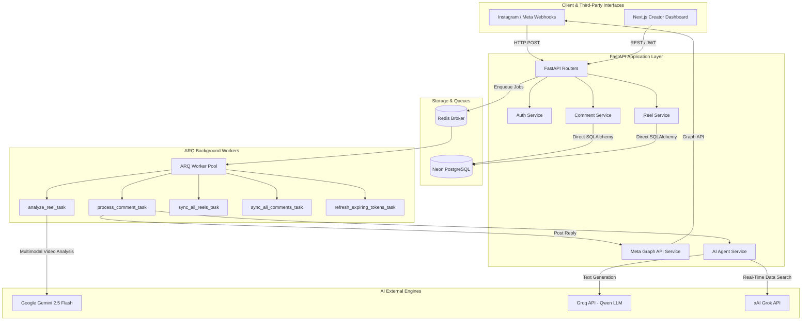
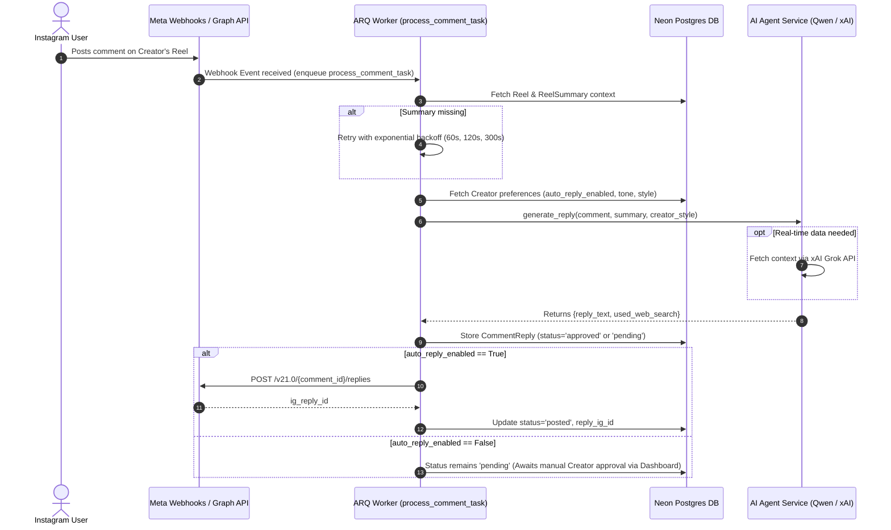
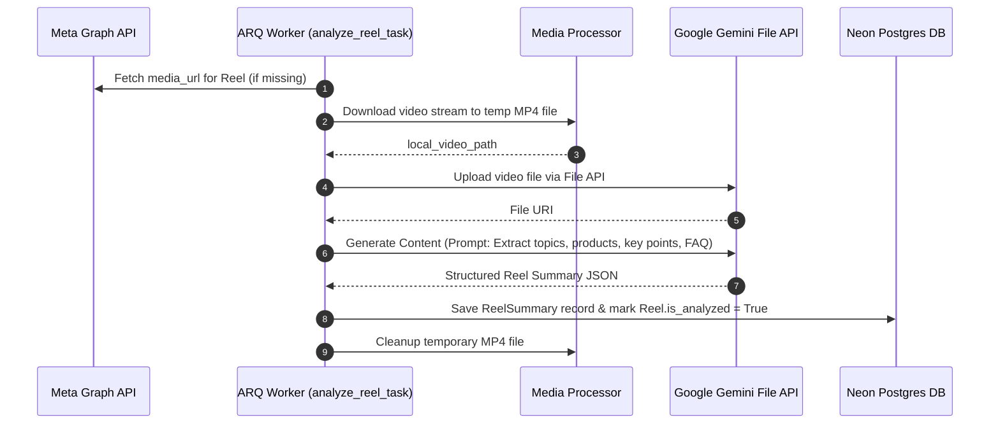
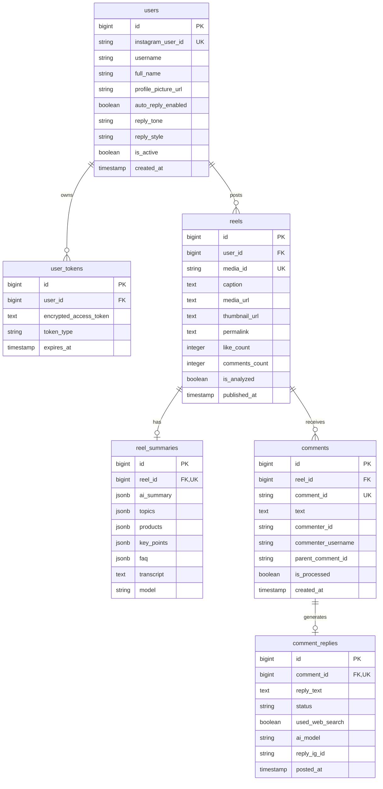

# Pilotly SaaS — System Design Document

**Pilotly** is a full-stack SaaS platform designed for Instagram creators to automate Reel comment management, AI-driven engagement, and personalized audience interactions.

---

## 1. Core Architecture Overview

Pilotly follows a **lean, asynchronous, event-driven micro-monolith** architecture built on FastAPI, Neon PostgreSQL, Redis, and ARQ worker queues. The codebase has been refactored for minimal overhead (repository abstraction layer removed, direct SQLAlchemy queries used).

---

## 2. AI Pipeline & Model Responsibility Matrix

To optimize cost (free tier preservation) and response quality, model responsibilities are strictly compartmentalized:

| AI Engine | Primary Responsibility | Model / Endpoint | Trigger Condition |
| :--- | :--- | :--- | :--- |
| **Google Gemini** | **Reel Video Analysis** | `gemini-2.5-flash` | Triggered when a new reel is uploaded/discovered. Downloads MP4, uploads via Gemini File API, extracts visual topics, products, key points, and FAQ. |
| **Qwen (via Groq)** | **Comment Reply Generation & Logic** | `qwen/qwen3.6-27b` | Triggered for every incoming comment. Evaluates if the question can be answered using Reel context. If missing information is required, requests real-time web search. |
| **xAI Grok** | **Real-Time Live Data Provider** | `https://api.x.ai/v1` | Called *only* when Qwen determines that real-time live data (e.g. current events, sports scores, live stats, external links) is required. |

### AI Workflow Logic (`AIAgentService`)
1. **Comment Received** + **Reel AI Summary** passed into `AIAgentService.generate_reply()`.
2. **Qwen Check**: Qwen checks if real-time web search is required to answer the user's comment accurately.
3. **If Real-Time Needed**: Queries xAI Grok API (`_fetch_realtime_context_via_xai`) for fresh ground-truth facts.
4. **Synthesis**: Qwen synthesizes the final reply adhering to the creator's voice, style, and tone preferences.

---

## 3. Core Data Flow & Workflows

### 3.1 Comment-to-Reply Pipeline (Sequence Workflow)

### 3.2 Reel Multimodal Analysis Pipeline

---

## 4. Database Schema (Neon PostgreSQL)

The database schema is lightweight and optimized for multi-tenant isolation via `user_id` / `instagram_user_id`.

---

## 5. Background Worker Cron & Queue Schedule

ARQ manages asynchronous execution with Redis:

| Task Function | Schedule / Trigger | Purpose |
| :--- | :--- | :--- |
| `process_comment_task` | On Demand (Webhook) | End-to-end processing of a single comment event. |
| `analyze_reel_task` | On Demand (Sync/Webhook) | Downloads Reel video & extracts Gemini AI summary. |
| `sync_all_reels_task` | Cron (Every 5 mins) | Discovers newly published Reels from active Meta accounts. |
| `sync_all_comments_task` | Cron (Every 2 mins) | Fallback sync for missed webhooks across 2 newest reels per active user. |
| `refresh_expiring_tokens_task` | Cron (Daily at 03:00 UTC) | Auto-refreshes Meta long-lived access tokens expiring within 7 days. |

---

## 6. Next Steps & Development Roadmap

1. **Phase 1: Next.js Frontend Dashboard** (Upcoming)
   - Account onboarding & Meta OAuth connect button
   - Creator settings panel (auto-reply toggle, reply tone/style customization)
   - Reel feed & summary viewer
   - Pending reply approval/rejection Inbox with single-click manual edit & post
2. **Comment-to-DM Engine**
   - Keyword-trigger rule matcher to send automated Instagram DMs (e.g. "Comment LINK for access")
3. **Multi-tenancy & Monetization**
   - Stripe / Razorpay integration with tier limits (e.g., Free Tier: 50 automated replies/mo, Creator Tier: unlimited).
